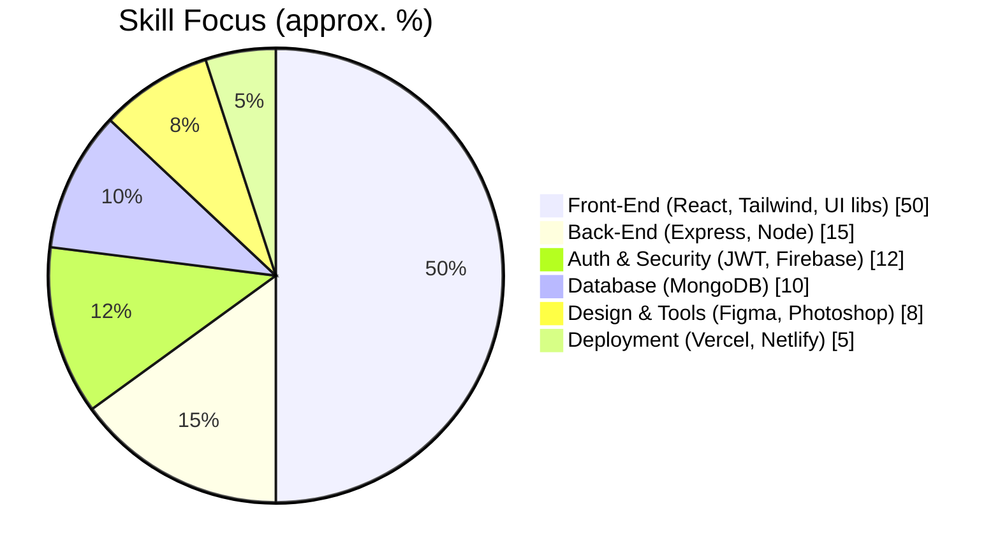
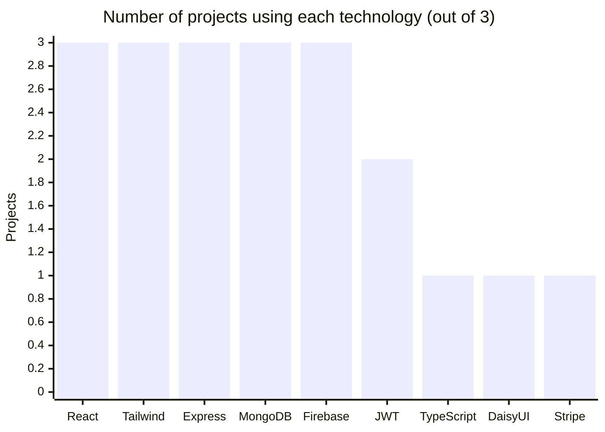
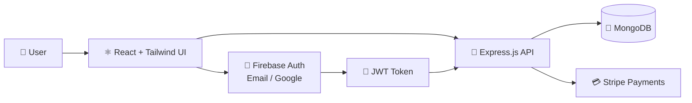
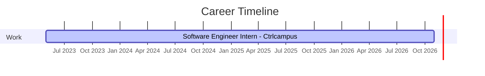

---

## 👨‍💻 About Me

- 💼 **Software Engineer Intern** at **Ctrlcampus Private Ltd**, Hyderabad, India (May 2023 – Present)
- 🎓 Studying **B.A. (Hons.)** at Jafar Ahmed College (expected graduation: **2027**)
- ⚛️ I build responsive, user-friendly web apps with **React.js** and **Tailwind CSS**
- 🔐 Experienced with **JWT & Firebase authentication**, dashboards, and **Stripe** payments
- 📍 Based in **Chattogram, Bangladesh**
- 🗣️ Languages: Bengali (Native) · English (Comfortable) · Hindi (Comfortable)
- 🌱 Currently learning **Redux**, **TypeScript** and **Next.js**
- 🌐 All my projects are on my [Portfolio](https://portfolio-kaiser-tanveer.netlify.app/)
- 📄 My experience and full [Resume](https://drive.google.com/file/d/1thnfu1wbIu6EoyPS4J3ftlO1QBoegiih/view?usp=sharing)
- 🎯 Looking for an entry-level role where I can grow my skills and contribute to the team's success

---

## 🛠️ Tech Stack

| Level | Technologies |
|-------|--------------|
| 🟢 **Expertise** | HTML · CSS · Bootstrap · Tailwind · DaisyUI · React.js · Express.js |
| 🔵 **Comfortable** | JavaScript · TypeScript · Redux · Node.js · JWT · MongoDB · GitHub · Netlify · Figma |
| 🟣 **Tools** | Chrome DevTools · Vercel · Photoshop · Firebase Authentication · Git · VS Code · Postman |
| 🟠 **Familiar** | Material UI · Next.js |

### 📊 Where My Skills Are Focused

### 📈 Technology Usage Across My Projects

### 🧩 How My Full-Stack Apps Work

---

## 💼 Experience

### Software Engineer Intern — *Ctrlcampus Private Ltd, Hyderabad, India*
`May 2023 – Present`

- Built and enhanced web applications with **React** as part of a developer team
- Took part in the full development lifecycle, from requirements gathering to delivery
- Debugged and troubleshot code to keep apps fast and reliable
- Worked with UI/UX designers to turn design concepts into consistent, polished interfaces
- Joined code reviews, giving feedback and applying best practices for quality and maintainability

---

## 🎓 Education

| Degree | Institution | Status |
|--------|-------------|--------|
| **B.A. (Hons.)** | Jafar Ahmed College | In progress · Expected 2027 |

---

## 🚀 Featured Projects

| Project | What it does | Tech |
|---------|--------------|------|
| 🏦 **Bravo-Bank**   [🌐 Live](https://bravo-bank.web.app/) · [Front-End](https://github.com/Kaiser-Tanveer/Bravo-Bank) · [Back-End](https://github.com/Kaiser-Tanveer/Barvo-Bank-Server) | Group banking project: open accounts, hold cards, request loans, deposit and transfer money. Admin dashboard to control all users. Email login and full CRUD. | `React` `TypeScript` `Tailwind` `DaisyUI` `Express` `Firebase` `MongoDB` |
| 📚 **LastBooks**   [🌐 Live](https://last-books.web.app/) · [Front-End](https://github.com/Kaiser-Tanveer/Last-Books-Client) · [Back-End](https://github.com/Kaiser-Tanveer/Last-Books-Server) | Second-hand book marketplace for students. Admin and seller dashboards, token-based verification, and Stripe payments. | `React` `JWT` `Tailwind` `Express` `Firebase` `Stripe` `MongoDB` |
| 🥦 **FoodMart**   [🌐 Live](https://food-mart-client.web.app/) · [Front-End](https://github.com/Kaiser-Tanveer/FoodMart-Client) · [Back-End](https://github.com/Kaiser-Tanveer/FoodMart-Server) | Garden-fresh food store with a seller-friendly flow. Easy product upload, Email and Google sign-in, and token-based access. | `React` `JWT` `Tailwind` `Express` `Firebase` `MongoDB` |

---

## 📊 GitHub Stats

---

## 🤝 Let's Connect

I'm open to **entry-level front-end roles**, internships, and collaboration.
**Let's build something great together!**

